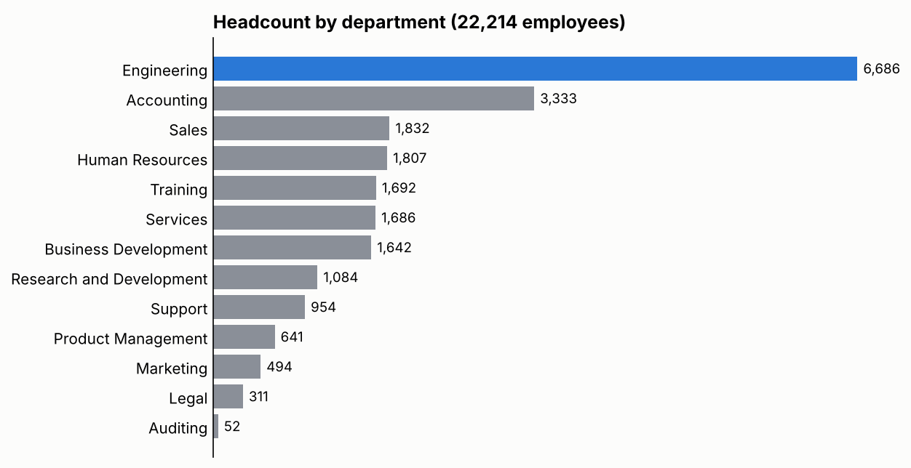
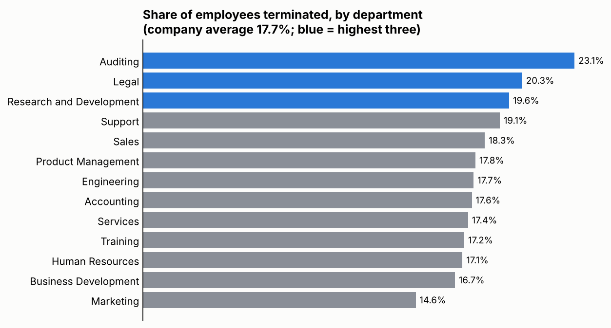
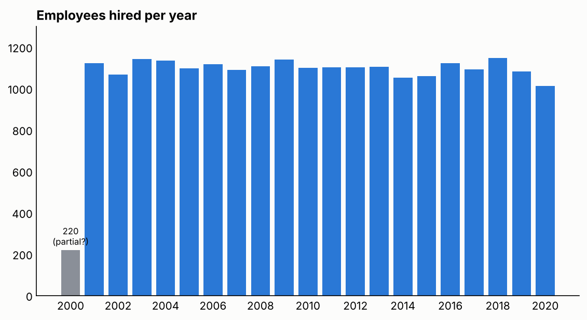
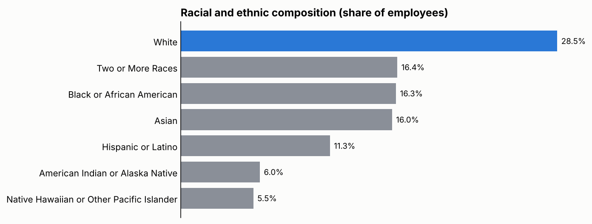

# HR Workforce Analysis (Excel PivotTables)

> An Excel analysis of 22,214 employees across 13 departments: headcount, gender, age, race and ethnicity, terminations and hiring trends. 82.3% of employees are active and 17.7% have been terminated.

## 🎯 Business Question

What does the workforce look like, who leaves, and how has hiring changed? Specifically:

- How large is each department, and how are gender and age spread across them?
- What is the racial and ethnic mix, overall and by department, job title and location?
- Do termination rates differ by department, gender and race?
- How many people were hired each year, and is the remote share growing?

## 📁 Data

- **Source:** HR employee dataset used in a data analysis course module
- **Size:** 22,214 employees (18,285 active, 3,929 terminated), hired between 2000 and 2020
- **Fields used:** department, job title, gender, age group, race and ethnicity, work location (headquarters or remote), hire year, termination date

## 🛠️ Tools

Microsoft Excel: PivotTables (12), PivotCharts (5), calculated ratios

## 🔄 Process

1. **Counted employees** by status, department, gender and age group.
2. **Built a Diversity & Inclusion sheet**: race by department, race and gender by job title, race and gender by location, and termination ratios.
3. **Built a Hiring Trends sheet**: hires and terminations per hire year, hires by department and year, and the headquarters / remote split by year.
4. **Checked the totals:** every PivotTable adds up to 22,214 employees, and active (18,285) plus terminated (3,929) matches.

## 🔍 Key Findings

- **Engineering is the largest department** with 6,686 employees (30.1%), followed by Accounting (3,333) and Sales (1,832). Auditing is the smallest, with 52.
- **17.7% of employees have been terminated.** Auditing (23.1%), Legal (20.3%) and Research and Development (19.6%) are highest. Marketing is lowest at 14.6%. Auditing and Legal are small, so their rates move a lot with a few people.
- **The workforce is split almost evenly by gender.** 50.8% are male, 46.5% female and 2.7% non-conforming, and males outnumber females in every department.
- **Terminations are slightly higher for women.** 18.1% of women have been terminated, against 17.4% of men and 17.0% of non-conforming employees. The gap is under a point, so it is small.
- **Terminations by race are close, with one outlier.** Rates range from 17.1% (Hispanic or Latino) to 18.1% (Two or More Races), but Native Hawaiian or Other Pacific Islander employees stand out at 19.4%.
- **White employees are the largest group** at 28.5%. No other group is above 16.4%. This mix is similar in almost every department.
- **Age is concentrated in the middle.** 25 to 54 makes up 81.4% of employees, 55 to 70 is 16.1%, and 18 to 24 is only 2.5%.
- **About 76% work at headquarters and 24% remote.** The remote share of new hires stays between 22% and 26% every year, so remote hiring is not growing.
- **Hiring is steady at about 1,050 to 1,150 a year** from 2001 to 2019. 2018 is the peak (1,147), and 2020 is lower at 1,012.

## ⚠️ Data Notes

- **2000 has only 220 hires**, far below every other year, so it is probably a partial year or the start of the data. It is not a real hiring dip.
- **"Terminated" means employees with a termination date.** This is a share of everyone ever hired, not an annual turnover rate.
- **The "turn over ratio" columns in the workbook** show each race's share within a gender, not a termination rate. The rates in this README are terminated employees divided by all employees in the group.
- Headcount does not show whether the company prefers one group. Males being the majority describes who works there, not how people were selected.
- Several job titles have only a handful of employees, so their race and gender splits are not reliable.
- The data looks synthetic. Confirm it is a sample dataset before publishing the workbook.

## ✅ Recommendations

- **Look into why Auditing, Legal and R&D lose more people**, for example through exit interviews and pay or workload comparisons.
- **Keep an eye on the gaps for women and Native Hawaiian or Other Pacific Islander employees.** They are small but consistent, so test whether they hold up in newer data.
- **Set a remote hiring goal if growth is wanted**, since the share has been flat for 20 years.
- **Add a hire-date and exit-date view** (tenure and annual turnover) to answer when people leave, which this workbook cannot.

## 📂 Files

- `workbook/hr-workforce-analysis.xlsx` – the Excel workbook with the PivotTables and charts
- `images/` – charts used in this README

## 👤 Author

Mohamed EL Maghawry · [LinkedIn](https://www.linkedin.com/in/mohamed-el-maghawry-a60232b4) · maghawry.17@gmail.com
